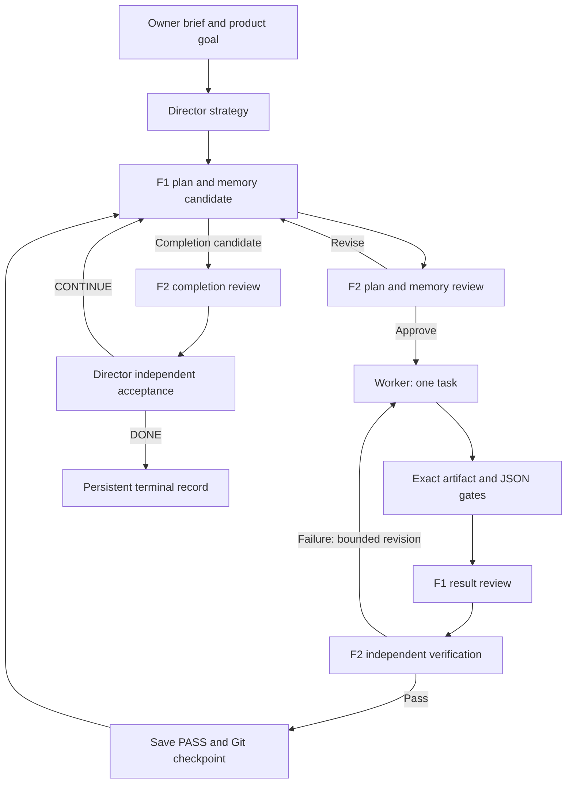

# Architecture and executable contracts

## Process model

`team_control.ps1 resume` is the outer launcher. `run_team.ps1` is the deterministic
supervisor. It derives ProjectRoot from scripts/, initializes output paths,
loads configuration and functions, validates the initial task selection, obtains
an exclusive `runner.lock`, checks Git, then dispatches role-specific CLI processes.
No database or queue server is required. The Python dashboard is a separate
loopback HTTP server. All runtime paths below are relative to
`out/orchestration/runtime/` unless otherwise stated.

The diagram shows the normal passing flow. Missing machine gates can produce
failure/escalation before result review. Exhausted technical attempts return to
planning/Director. Task-only diagnostics can execute a supplied manifest without
the planning loop. PlanFirst requires Director and both reviews.

## Source map

| File | Responsibility |
|---|---|
| scripts/run_team.ps1 | Manifests, task/round state machine, gates, role prompts, review parsing, Director consultations |
| Start Agent App.cmd, scripts/start_team_app.ps1, scripts/team_app.py | Bootstrap local venv and open a dedicated Edge/Chrome app window; reuse only a matching dashboard/runtime |
| scripts/orchestration_runtime.ps1 | Fresh CLI calls, stdin transport, timeout cleanup, logs, retries, fingerprints, handoffs |
| scripts/team_config.ps1 | Shared model/fingerprint configuration reader |
| scripts/team_context.ps1 | Immutable messages, candidate validation, frozen reviews, approved snapshots, context packets |
| scripts/director_control.ps1 | Valid pause/terminal records and emergency-hold authority |
| scripts/foreman1_hold.ps1 | Narrow temporary-hold entrypoint |
| scripts/team_control.ps1 | Status/pause/resume, notifications, persistent repair launcher |
| scripts/supervisor_repair.ps1 | Allowlisted maintenance, regression checks, F2 review, checkpoint |
| scripts/director_console.ps1 | Read-only Director response to durable owner messages |
| scripts/team_dashboard.py and dashboard/index.html | Loopback status UI, message input, Director/supervisor dispatch |
| scripts/team_git.py | Branch/remote checks, source-only checkpoints and optional approved pushes |
| scripts/usage_limits.ps1 and codex_usage.py | Provider classification, persisted cooldowns, Codex usage inquiry |
| scripts/team_notifications.ps1 | Deduplicated optional event alerts |
| scripts/refresh_team_memory.ps1 | F1/F2-only memory bootstrap or maintenance |

## Role transport and permissions

Worker executes OpenCode via a cmd pipe. Foreman1 executes Claude non-interactively
with redirected stdin. Director/F2 execute Codex and read output-last-message
files instead of trusting stdout progress. Models come from orchestration.json;
runner arguments can override them. Model strings and effort values are validated
before composing commands. WorkerCmd is intentionally a trusted shell override.

Every call gets unique prompt, stdout, stderr and final-answer paths. Normal
transport retries a failed/empty response once; terminal provider failures return
ERROR. Explicit transient failures wait five seconds before retry. Quota failures
persist provider-specific state, wait, and retry the original assignment with
partial-work recovery instructions. Director and F2 share the OpenAI quota record.

During a child call, the runtime heartbeat refreshes roughly every five seconds.
Timeout uses taskkill /PID /T /F on the launched process tree. It reports TIMEOUT
only if cleanup succeeds and the process exits; otherwise CLEANUP-ERROR. Pending
operation records survive failures for investigation, and are archived on later
attempts. Crash recovery reconstructs files; it does not resume a private vendor
conversation or guarantee exactly-once external side effects.

The main Codex adapter uses inherited automatic approval mode; the owner console
uses an explicit read-only sandbox. Most role write limits and stop authority are
cooperative protocol requirements plus file validation, not OS-enforced identities.
Agents sharing write access could forge files. Do not treat these controls as
isolation from malicious agents. Only one project writer is dispatched, but the
read-only Director console can run concurrently.

## Planning and result formats

| Producer | Required machine-readable response |
|---|---|
| Director | First line `DECISION: CONTINUE`, `DECISION: DONE`, or `DECISION: BLOCKED` |
| F2 plan/outcome review | First line `VERDICT: APPROVE`, `VERDICT: REVISE`, or `VERDICT: BLOCKED` |
| F1 task review | First line `VERDICT: PASS`, `VERDICT: FAIL`, or `VERDICT: ESCALATE` |
| F2 task verification | First line `VERDICT: AGREE` or `VERDICT: DISAGREE`; second line `TASK_VERDICT: PASS`, `FAIL`, or `ESCALATE` |
| Dashboard Director direction | First line `DIRECTION: QUEUE`, `REPLAN`, or `PAUSE` |

Extra evidence follows these lines. Prefix matching is anchored to the start of
the response. Invalid/empty responses do not grant approval. F2's task verdict
controls acceptance; disagreement is sent back with correction evidence.

F1 writes exactly one signal in each planning call: next_round.txt (manifest
path), COMPLETION_REPORT.md, director_request.md, or OWNER_QUESTIONS.md. Multiple,
empty or malformed signals are planning errors. Previous signals are archived.
Every outcome must also provide a valid memory/candidate.json. Plans get bounded
revisions; unresolved disagreements route to Director and still require F2 approval.
Three unsuccessful rounds trigger a new Director strategy consultation. Positive
MaxRounds triggers a Director review boundary and resets the counter, not a stop.

DONE is accepted only during a completion consultation after the reviewed candidate.
Saved director_plan.md is reused until a consultation changes strategy. The
supervisor does not routinely ask Director between every task or round.

## Gate and cache semantics

Manifest validation enforces document/output containment, bounded task counts,
timeouts and recognized JSON gate schemas; see SETUP.md for examples. File gates
require the exact path and never search old runs for a similarly named artifact.
JSON gates parse the file and compare dotted-path or JSON Pointer values.
They are artifact checks, not a test command runner. Real validation is assigned
to the worker and independently checked by reviewers.

state.json stores task, round, status, verdict, timestamp and fingerprint.
A PASS can be reused only when its task document, gate files and configured
fingerprint roots have the same hashes. Missing inputs invalidate reuse.
The generic extraction expands the original Python-only fingerprint coverage
to configured recursive source/configuration paths. Incomplete configuration
can still miss relevant inputs; external services/environment state is not hashed.

Git checkpoints run after reviewed PASS. Pauses, holds and recoverable supervisor
errors may create explicitly unapproved local checkpoints. These are restart
points, not completion evidence. Source files have conservative type/size checks;
deletion, symlinks, staged changes or a wrong remote halt automated checkpointing.

## Durable memory and messages

Read CONTEXT_PROTOCOL.md for exact candidate JSON. Context starts from owner policy,
approved summary, paged inbox and latest task states. Budgets are characters:

| Component | Limit |
|---|---:|
| Owner brief | 5,000 |
| Approved summary | 8,000 |
| Inbox batch | 8 messages / 6,500 |
| Context packet | 24,000 |
| Assignment | 24,000 |
| Full initial request | 52,000 |
| Individual message body | 3,000 |

These bounds do not constrain all later reads or total model tokens. Agents must
retrieve evidence selectively. Published snapshots and messages are immutable by
protocol; the supervisor atomically switches current.json after validation.
F2 reviews a frozen candidate/evidence bundle; hashes are rechecked before publish.
Evidence/state changes mark memory stale. No initial summary is assumed.

Message JSON is authoritative, Markdown is its readable copy. Messages include
ID, from/to role, task, kind, body, evidence and optional reply_to. Replying or
reading never closes a question. F1 proposes a disposition and F2 approves it
with candidate memory. Publication closes approved resolutions. Completion cannot
silently omit unresolved questions. Messages are consumed at call boundaries.

## Runtime records

| Record | Purpose |
|---|---|
| runner.lock | Exclusive supervisor/memory/repair ownership |
| runtime.json | Current role, action, heartbeat, supervisor PID, status and log path |
| pending-operation.json | In-flight or interrupted process details |
| state.json | Latest task/round outcomes and fingerprints |
| communications.md, digest.md, runner.log | Handoffs, outcomes and coordinator diagnostics |
| director_plan.md | Saved strategic direction |
| no-progress.json | Failed round and recovery counters |
| memory/messages, snapshots, packets | Durable messaging, approved context and exact initial inputs |
| director-pause.json + STOP.txt | Authorized pause/replan |
| hard-stop.json | Director DONE/BLOCKED |
| foreman1-hold.json + FOREMAN1-HOLD.txt | Temporary evidence-backed hold |
| usage-*.json | Shared provider cooldowns |
| director-console.json, director-console.lock | Independent owner conversation state |
| github-backup.json | Optional destination-specific standing push authorization |
| notifications.json | Local optional notification configuration |

STOP.txt alone is ignored by dispatch checks; it must have a valid Director pause
record. Pause requests from the owner command are handled deterministically
without consuming a model call. F1 hold additionally requires a concrete integrity
problem and persisted active Director-provider quota. Ordinary resume cannot
clear Director terminal decisions.

## Recovery limits and operations

The outer launcher can ask Director to repair allowlisted orchestration files,
run regression checks, obtain independent F2 approval and checkpoint before a
restart. Each batch allows two repair attempts. The launcher can wait and start
another batch indefinitely; this is not a global two-attempt ceiling. It does
not run at OS boot and cannot survive machine shutdown without relaunch.

Quota waits honor pause checks, retain original assignments and prohibit silent
model substitution. Some provider time formats are explicitly supported; unknown
reset times remain unknown with periodic checks rather than invented estimates.
MaxHours does not bound every wait. Owner-console calls have different lifecycle
handling from the main process adapter. Monitor long-running services and use pause.

The dashboard is a writable control surface on loopback. Do not port-forward it
as an authenticated remote control service. Notifications are optional external
POSTs; routine progress stays local. GitHub is a source backup only: ignored
runtime/memory/evidence needs a separate backup if it must be retained.

The GUI has Director, Dashboard and Guide views. POST /api/control/pause uses the
same Host/Origin/JSON restrictions as owner messages and invokes the deterministic
team_control pause helper asynchronously. app-control.json exposes PAUSING,
PAUSED or ERROR. A pending direction's automatic execution is canceled by an owner
pause; subsequent explicit directions can resume. PAUSED is reported only after
the helper exits successfully. Role labels come from the saved model config.
